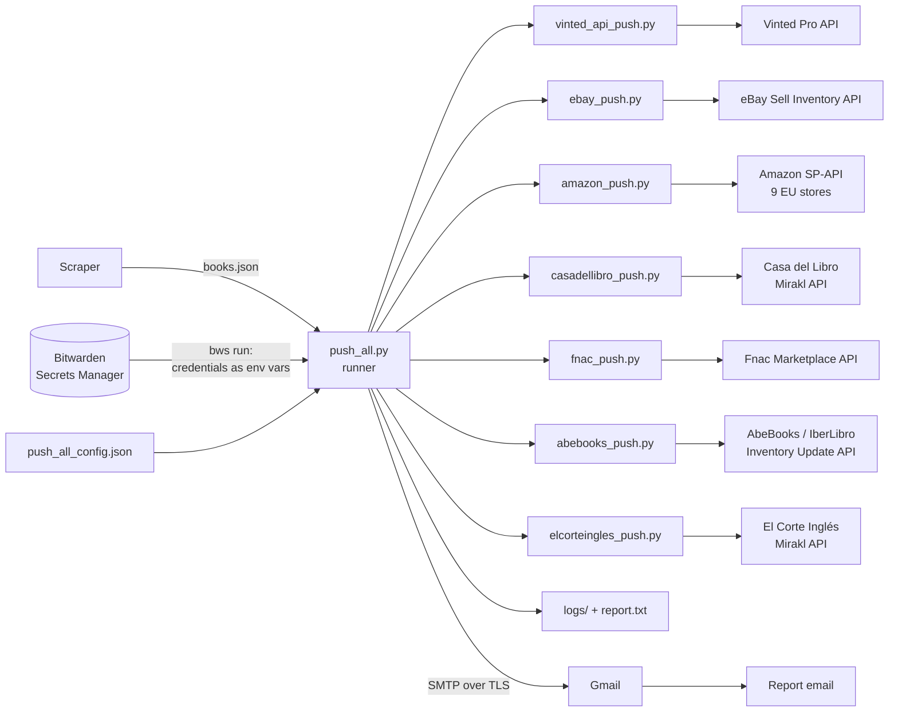

# Architecture

This document describes how the product pushers solution is built: its parts,
how data and credentials flow through it, how it runs on a server, and what
has been verified so far. The setup and use of each part are covered in the
other documents in `docs/`.

- [Purpose](#purpose)
- [Overview](#overview)
- [Components](#components)
- [Marketplace integrations](#marketplace-integrations)
- [Run flow](#run-flow)
- [Data and state](#data-and-state)
- [Credentials and security](#credentials-and-security)
- [Deployment](#deployment)
- [Error handling and monitoring](#error-handling-and-monitoring)
- [Testing](#testing)
- [Current status](#current-status)
- [Adding a marketplace](#adding-a-marketplace)

## Purpose

Book products scraped from a source shop are listed automatically on seven
marketplaces through their **official seller APIs**. After every run, one
email reports what happened on each marketplace.

## Overview

The solution has three layers:

1. **Input**: the scraper's products JSON, plus the run configuration.
2. **Pushers**: seven independent scripts, one per marketplace. Each turns the
   common product format into that marketplace's API calls.
3. **Orchestration and reporting**: `push_all.py` runs the enabled pushers,
   works out each one's result, saves logs, and emails one report through
   Gmail.

Credentials come from Bitwarden Secrets Manager at run time and are never
stored in the code, the repository, or the configuration.

## Components

| Component | Responsibility | Technology |
|---|---|---|
| Scraper (separate project) | Produces `books.json`: id, title, price, ISBN, condition, images, stock | Python |
| `push_all_config.json` | Which pushers run, their options, products file, report recipients, timeouts | JSON, not in git |
| **`push_all.py`** | Runs the pushers one after another, counts results, writes logs, sends the email, prevents overlapping runs | Python standard library only |
| 7 pushers (`*_push.py`) | One per marketplace: validate products, match the catalog, create or update listings, record what was pushed | Python + `requests` (Vinted: standard library) |
| State files (`*_posted.json`) | Per marketplace, what has already been pushed, so re-runs don't duplicate | JSON, local, not in git |
| Bitwarden Secrets Manager + `bws` | Stores all credentials and injects them as environment variables at start-up | Bitwarden cloud, `bws` 2.1.0 |
| Gmail account | Sends the report (SMTP, port 465, TLS, App Password) | Gmail |
| `logs/<date_time>/` | Full output of every pusher plus the report text, per run | Text files, not in git |
| Tests (`tests/`) | A fake API server per marketplace, plus a fake mail server for the runner | Python |

Every pusher also runs on its own (for example
`python amazon_push.py push --limit 1`). The runner only calls the pushers; it
doesn't contain any marketplace logic.

## Marketplace integrations

| Marketplace | API | Authentication | How a book is listed | Documentation |
|---|---|---|---|---|
| Vinted | Vinted Pro Integrations API | Access key + signing key; every request is HMAC-SHA256 signed | Creates a new item (own photos, text, price). Processed asynchronously. | Official, public |
| eBay (EU) | Sell Inventory API | OAuth refresh token | Inventory item → offer → publish | Official, public |
| Amazon (ES, DE, FR, IT, NL, BE, PL, SE, IE; UK optional) | Selling Partner API: Catalog Items + Listings Items | Login with Amazon refresh token | Finds the existing Amazon page by ISBN in each store, adds an offer (price, condition, stock). Converts SEK/PLN/GBP prices. | Official, public |
| Casa del Libro | Mirakl seller API | API key | Matches the catalog by EAN, uploads all offers as one CSV import, reads the error report | Mirakl standard |
| Fnac | Fnac Marketplace API v2.6 (XML) | Partner ID + shop ID + key → session token | Sends offers by EAN in batches, polls the batch status | Official, public |
| AbeBooks / IberLibro | AbeBooks Inventory Update API (XML) | Username + API key | Describes its own copy of a book; no catalog match needed. Add / update / delete. | Official PDF |
| El Corte Inglés | Mirakl seller API | API key | Same flow as Casa del Libro | Mirakl standard; El Corte Inglés doesn't publish its own documentation |

All pushers read the same input format and apply the same base rules: skip
sold-out or incomplete products, map the condition, and convert ISBN-10 to
EAN-13 where the API needs it.

## Run flow

1. A scheduler (cron or Windows Task Scheduler) starts
   `bws run -- python push_all.py`.
2. `bws` signs in to Bitwarden with the machine's access token, fetches the
   secrets of the `product-pushers` project, and starts `push_all.py` with them
   as environment variables.
3. `push_all.py` takes a lock file, so a second run can't start while one is
   still going.
4. For each enabled pusher in the config:
   1. If its credentials are missing, it's reported as `NOT CONFIGURED` and not run.
   2. Otherwise, the runner reads the pusher's state file, runs it as a
      separate process with `--yes` and a timeout, then reads the state file
      again.
   3. The result is worked out:
      - **pushed**: new or changed state entries
      - **skipped**: `SKIP` lines in the output
      - **rejected**: `!` lines and batch errors
      - **failed**: a non-zero exit code or a timeout
5. The output is saved to `logs/<date_time>/<pusher>.log`.
6. The report (a plain-text version and an HTML table, with the full log
   attached) is emailed through Gmail.
7. The lock is released. The exit code is `0` (OK), `1` (a pusher failed) or
   `2` (the email couldn't be sent).

Pushers run one after another, not in parallel. That keeps within each
marketplace's rate limits, and one pusher failing doesn't stop the others.

## Data and state

- **Input:** one products JSON (scraper output). The format is shown in
  [products.example.json](../products.example.json).
- **State:** each pusher keeps a JSON file of what it pushed (SKU → listing ID,
  time). This prevents duplicate listings on re-runs, and it's also how the
  runner counts what was pushed.
- **Updates:**
  - `--resend` re-sends price and stock (Amazon, Casa del Libro, Fnac,
    AbeBooks, El Corte Inglés).
  - AbeBooks can also delete listings for books that are now sold out.
- **Output files:**
  - logs per run
  - the last generated offer file per marketplace (CSV/XML), so you can check
    exactly what was sent

## Credentials and security

| Decision | Reason |
|---|---|
| All credentials live in **Bitwarden Secrets Manager** (project `product-pushers`) | One managed place, team access, access log, change a key without touching the server. The free plan is enough. |
| The server has only one **machine-account access token**, with read-only access to that one project | Smallest possible secret on disk. Each machine can be revoked separately. |
| Credentials reach the scripts only as **environment variables** (`bws run`) | No secrets in code, git or config. The secrets store can be swapped (`.env`, Doppler, Vault) without code changes. |
| Gmail uses an **App Password** on a dedicated account | Revocable without changing the account password; a personal mailbox isn't exposed. |
| Mail is sent only over **TLS** | The runner refuses to send the password to a server without TLS. |
| `.env`, config, state and logs are in **`.gitignore`** | Nothing local or secret reaches GitHub. Every commit is also scanned for secrets before it's pushed. |

The full setup steps are in
[push_all.md → Where credentials are stored](push_all.md#where-credentials-are-stored).

## Deployment

| Item | Value |
|---|---|
| Runtime | Python 3.8 or newer, `requests`, `bws` |
| Code | This repository, cloned on the server |
| Configuration on the server | `push_all_config.json` and the Bitwarden access token (file with mode 600 on Linux, or a user environment variable on Windows) |
| Schedule | Once a day, after the scraper. Linux: cron. Windows: Task Scheduler (commands in [push_all.md](push_all.md#running-it-on-a-server)). |
| Input | The scraper must run on the same server, or copy `books.json` to it before the push |

## Error handling and monitoring

| Situation | Behaviour |
|---|---|
| One product is invalid | Skipped with its reason; the others continue |
| A marketplace rejects one offer | Shown in the report with the marketplace's message; not recorded, so it's retried next run |
| Temporary API error (429/5xx, AbeBooks 1xx) | Retried automatically with backoff by the Amazon, Casa del Libro, Fnac, AbeBooks and El Corte Inglés pushers. Vinted and eBay report the error, and the item is retried on the next run. |
| Wrong credentials or a pusher crash | That pusher is `FAILED`, with its last output lines in the email; the others still run |
| A pusher hangs | Killed after `timeout_minutes`, reported as `FAILED` |
| Two runs overlap | The second one stops (lock file) |
| The email can't be sent | Exit code 2, visible in the scheduler; the report is still in `logs/` |
| Bitwarden unreachable | The run doesn't start; visible only in the scheduler or the cron log, since the email password is in Bitwarden too |

## Testing

Every component has an automated test that runs on a single machine, needs no
credentials, and doesn't contact any real API:

| Test | What is faked | Checks |
|---|---|---|
| `test_vinted_api.py` | Vinted Pro API (including HMAC signature verification) | 15 |
| `test_ebay.py` | eBay APIs | 9 |
| `test_amazon.py` | SP-API: Catalog, Listings, Login with Amazon | 21 |
| `test_casadellibro.py` | Mirakl API | 21 |
| `test_fnac.py` | Fnac XML API | 17 |
| `test_abebooks.py` | AbeBooks Inventory Update API | 22 |
| `test_elcorteingles.py` | Mirakl API | 21 |
| `test_push_all.py` | Fake pushers + fake mail server | 24 |
| **Total** | | **150, all passing** |

The fakes enforce the rules from each marketplace's documentation: required
fields, limits, error codes, and asynchronous processing.

## Current status

| Part | Status |
|---|---|
| All 7 pushers | Built and passing their tests. **Not yet run against the real marketplaces**, because there are no seller accounts or API credentials yet. |
| Runner + email report | Built and tested. **Verified for real on 2026-11-05**: credentials from Bitwarden, test email and dry-run report delivered through Gmail. |
| Bitwarden Secrets Manager | Set up and working (project, machine account, token, `bws` 2.1.0). |
| Server | Not yet deployed. The commands and steps are documented. |

**Next steps:**

1. Get seller accounts and API access for each marketplace.
2. Add their credentials to Bitwarden.
3. Do a safe first run per marketplace: `--dry-run` or `--validate-only`,
   then `--limit 1`.
4. Deploy to the server and schedule it.

**Known constraints:**
- New books in Spain, France and Germany have legally fixed prices, so
  `--price-factor` must not exceed the cover price.
- Vinted, Amazon and the Mirakl marketplaces process listings asynchronously:
  "pushed" means accepted, and each pusher's `status` command shows the final
  state.
- El Corte Inglés's API details are based on the Mirakl standard, so its first
  real run will confirm them.

## Adding a marketplace

1. Write `<name>_push.py`. It should:
   - read the common products JSON
   - read its credentials from environment variables
   - support `--yes` and a safe mode (`--dry-run` or `--validate-only`)
   - record successes in `<name>_posted.json`
   - print `SKIP …` for skipped products and `   ! …` for rejected ones
2. Add an entry to `PUSHERS` in `push_all.py` (script, state file, credential
   names, safe-mode flag) and to `push_all_config.example.json`.
3. Add its secrets to Bitwarden and its names to `.env.example`.
4. Add `tests/test_<name>.py` with a fake of its API, and `docs/<name>_push.md`.
